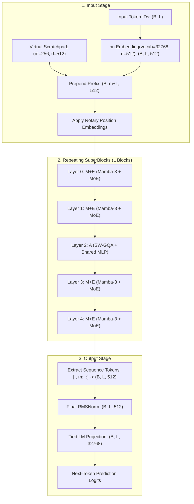

# NEXA-SLM Architecture Documentation

**Research Title:** NEXA-SLM: A Scalable Hybrid Mamba-Attention MoE Small Language Model  
**Authors:** Soham Joshi, Srihari Mhaisekar, Tanmayee Ozarkar, Tanay Mehta  
**Project Mentor:** Dr. Jitendra Musale  
**Institution:** Department of AI & Data Science, ABMSP's Anantrao Pawar College of Engineering & Research, Pune  

---

## 1. High-Level Architectural Philosophy

NEXA-SLM departs from conventional dense Transformers by decoupling sequence mixing from high-memory quadratic attention, and decoupling model capacity from active per-token compute:

1. **80% Linear Sequence Mixing:** Four out of five sublayers in every SuperBlock use Mamba-3, providing $\mathcal{O}(n)$ sequence modeling with constant recurrent state.
2. **20% Precision Retrieval:** One sublayer in every SuperBlock uses Sliding Window Grouped Query Attention (SW-GQA), providing high-precision local lookup and access to persistent prefix memory.
3. **Decoupled Parameter Capacity:** Sparse Mixture-of-Experts (MoE) provides 8 routed experts (Top-2 active) plus 1 shared expert, cutting active FLOPs by 66% in the FFN sublayers while keeping expert weights resident in memory.
4. **Context-Independent Memory Footprint:** The Key-Value cache is strictly bounded by $W + m$ tokens. At 16K context, the KV cache is 160× smaller than a dense Transformer.

---

## 2. Comprehensive Data Flow & Tensor Dimensional Transformations

---

## 3. Mathematical Formulations

### 3.1 Input Formulation
Let input tokens be $T \in \mathbb{R}^{n \times d}$ and learnable scratchpad vectors be $P \in \mathbb{R}^{m \times d}$, where $m \in [128, 256]$:

$$Z_0 = \text{RoPE}([P ; T])$$

$$Z_{l+1} = Z_l + F_l(\text{RMSNorm}(Z_l))$$

---

### 3.2 Mamba-3 Exponential-Trapezoidal Formulation
The Mamba-3 sublayer discretizes the continuous-time state-space equation $\dot{h}(t) = A h(t) + B(t) x(t)$ using trapezoidal quadrature with an input-dependent mixing parameter $\lambda_t \in (0, 1)$ (Lahoti et al., 2026; Paper Eqs. 3–4):

$$h_t = \alpha_t h_{t-1} + \beta_t (x_{t-1} \otimes B_{t-1}) + \gamma_t (x_t \otimes B_t)$$

$$y_t = C_t^\top h_t + D x_t, \quad \text{output} = \text{out\_proj}(y_t \odot \text{SiLU}(z_t))$$

where:
- $\alpha_t = \exp(\Delta_t A)$ (state decay)
- $\beta_t = (1 - \lambda_t) \Delta_t \exp(\Delta_t A)$ (trapezoidal weight on previous input)
- $\gamma_t = \lambda_t \Delta_t$ (trapezoidal weight on current input)
- $\Delta_t = \text{softplus}(\text{dt\_proj}(x_{\text{conv}, t}))$
- $\lambda_t = \text{sigmoid}(\text{lam\_proj}(x_{\text{conv}, t})) \in (0, 1)$
- $B_t, C_t \in \mathbb{R}^{d_{\text{state}}}$, projected from $x_{\text{conv}, t}$.

---

### 3.3 SW-GQA Formulation
For $H$ query heads sharing $G$ key/value groups ($H / G = 4$), sliding window $W = 256$, and scratchpad prefix $m = 256$:

$$O_h = \text{softmax}\left(\frac{Q_h K_{g(h)}^\top}{\sqrt{d_k}} + M\right) V_{g(h)}, \quad g(h) = \lfloor h \cdot G / H \rfloor$$

$$M_{ij} = \begin{cases} 0 & \text{if } j < m \text{ (Scratchpad)} \text{ or } (i - W < j \le i) \text{ (Sliding Window)} \\ -\infty & \text{otherwise} \end{cases}$$

---

### 3.4 Mixture of Experts (MoE) Formulation
The MoE sublayer consists of $N = 8$ routed SwiGLU experts, Top-2 routing, and 1 shared SwiGLU expert:

$$g(x) = \text{softmax}(W_r x), \quad W_r \in \mathbb{R}^{d \times 8}$$

$$\tilde{g}_i(x) = \frac{g_i(x)}{\sum_{j \in \text{Top-2}(g)} g_j(x)}$$

$$\text{MoE}(x) = E_s(x) + \sum_{i \in \text{Top-2}(g)} \tilde{g}_i(x) E_i(x)$$

Routing stability is enforced using two auxiliary objectives:
1. **Load-Balancing Auxiliary Loss:**
   $$L_{\text{aux}} = N \sum_{i=1}^N f_i P_i$$
   where $P_i = \frac{1}{B \cdot L} \sum g_i(x)$ is mean router probability, and $f_i$ is fraction of tokens dispatched to expert $i$.
2. **Router Z-Loss (ST-MoE):**
   $$L_z = \frac{1}{B \cdot L} \sum_{t=1}^{BL} \left(\log \sum_{i=1}^N \exp(z_i^{(t)})\right)^2$$

Total training loss:
$$L_{\text{total}} = L_{\text{CE}} + \lambda_{\text{aux}} L_{\text{aux}} + \lambda_z L_z$$

---

## 4. Analytical Memory Bounds (KV Cache & Recurrent State)

The attention cache is strictly constant in context length $n$:

$$M_{\text{KV}} = 2 \cdot L_{\text{blocks}} \cdot n_{\text{kv}} \cdot d_h \cdot (W + m) \cdot b \text{ bytes}$$

For the Research POC configuration ($L_{\text{blocks}} = 4$, $n_{\text{kv}} = 2$, $d_h = 64$, $W = 256$, $m = 256$, FP16 $b = 2$):

$$M_{\text{KV}} = 2 \times 4 \times 2 \times 64 \times (256 + 256) \times 2 = 1,048,576 \text{ bytes} = \mathbf{1.0 \text{ MiB}}$$

| Context Length $n$ | Dense Transformer (20 layers) | NEXA-SLM (4 SuperBlocks) | Memory Reduction |
|---|---|---|---|
| **2,048 tokens** | 20.0 MiB | 1.0 MiB | **20×** |
| **4,096 tokens** | 40.0 MiB | 1.0 MiB | **40×** |
| **8,192 tokens** | 80.0 MiB | 1.0 MiB | **80×** |
| **16,384 tokens** | 160.0 MiB | 1.0 MiB | **160×** |
| **32,768 tokens** | 320.0 MiB | 1.0 MiB | **320×** |
